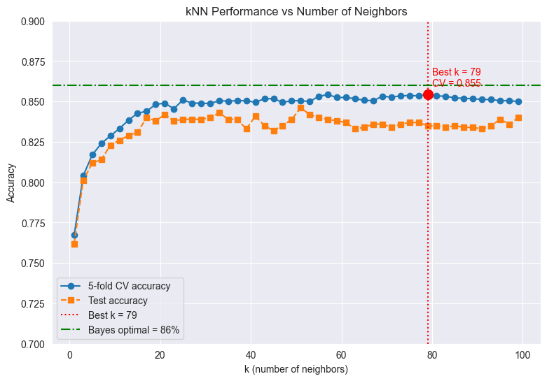
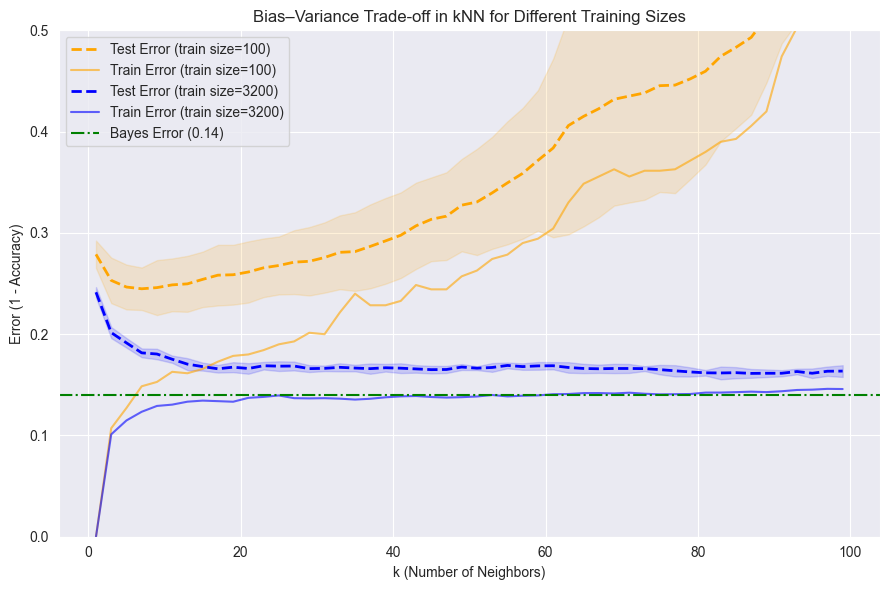
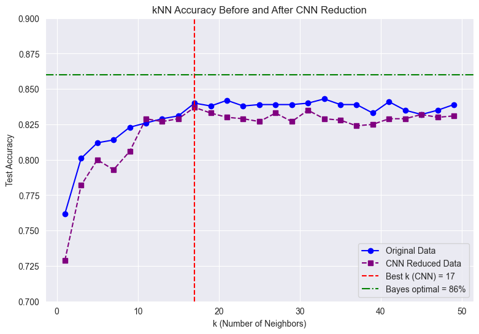
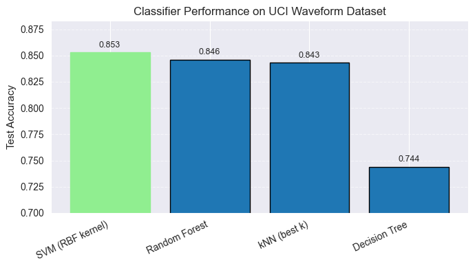

# Waveform Classification with kNN and Instance Reduction


How close can a well-tuned **k-Nearest Neighbors** classifier get to the theoretical best on a noisy dataset? And how much of the training data can we discard before accuracy suffers?

This project tunes kNN on the classic **Waveform** dataset (Breiman et al.), studies its bias–variance behaviour, implements two **instance-reduction** algorithms (CNN and an RNN-style method) from scratch, and benchmarks kNN against Decision Tree, Random Forest and RBF-SVM.

> Masters in Machine Learning & Data Mining, Université Jean Monnet, Saint-Étienne (2025–2026)
> 📄 Full write-up: [`Waveforms_Project.pdf`](Waveforms_Project.pdf)

---

## ✨ Key results

| | Result |
|---|---|
| **Best k** (5-fold CV over odd k = 1…99) | **k = 79** |
| kNN cross-validation accuracy | **0.855** |
| kNN test accuracy | **0.835**, which is 2.5 points below the Bayes-optimal **≈ 0.86** |
| Best model on test set | **SVM (RBF): 0.853** |
| CNN reduction | keeps **2,110 / 4,000** samples (**−47%**), with 1-NN accuracy 0.762 → 0.729 |
| RNN-style reduction | keeps **2,400 / 4,000** samples (**−40%**), with 1-NN accuracy 0.762 → 0.757 |

**Takeaway:** a properly tuned, standardized kNN comes within a few points of the theoretical limit. Kernel and ensemble methods are only slightly better. CNN can nearly halve the training set, and with a larger k the accuracy cost is under one point.

---

## 📊 Highlights

### 1. Choosing k


Accuracy rises quickly up to k ≈ 20 and then plateaus. Very small k overfits the noise in the data, which is high variance. The 5-fold CV curve peaks at **k = 79**, and the green line marks the Bayes-optimal accuracy of ~86%.

### 2. Bias–variance vs training-set size


The experiment repeats training 7 times on random subsets of **100** and **3,200** samples. With only 100 samples the test error is high and unstable, and it climbs as k grows because large k oversmooths. With 3,200 samples the error is flat and close to the Bayes error (0.14) for a wide range of k. More data both lowers variance and makes the choice of k less critical.

### 3. Instance reduction (CNN)


**Condensed Nearest Neighbour** (Hart, 1968) keeps only the samples needed to classify the rest correctly. Here it starts from a random 5% seed set. It removes **47%** of the training data. Accuracy falls noticeably for 1-NN, but for k ≥ 11 the reduced set stays within about 1 point of the full set.

### 4. Classifier comparison


| Model | Test accuracy |
|---|---|
| SVM (RBF kernel) | **0.853** |
| Random Forest (100 trees) | 0.846 |
| kNN (k = 79, CV-selected) | 0.835 |
| Decision Tree | 0.744 |

The waveform classes overlap smoothly, which suits SVM and kNN. A single decision tree, with its axis-aligned splits, does markedly worse.
<sub>The bar chart shows kNN at 0.843. That value used a k chosen on the test set. The table reports the CV-selected k, which is the unbiased estimate.</sub>

---

## 🧪 Methodology

- **Data:** 5,000 samples × 21 continuous noisy features, 3 balanced classes (~33% each), no missing values.
- **Split:** stratified 4,000 train / 1,000 test (`random_state=42`).
- **Preprocessing:** z-score standardization. `StandardScaler` is fit on the training set only, so no information leaks from the test set.
- **Tuning:** 5-fold cross-validation over odd k from 1 to 99.
- **Bias–variance:** train/test error vs k for training sizes 100 and 3,200, each averaged over 7 random draws.
- **Instance reduction:** implemented from scratch with scikit-learn's `NearestNeighbors`:
  - **CNN:** iterative condensing from a random seed set until no sample is misclassified.
  - **RNN-style:** tries to remove candidate samples one at a time when removal does not reduce accuracy (see limitations).
- **Baselines:** Decision Tree, Random Forest (100 trees), SVM with RBF kernel, all trained on the same standardized data.

---

## 🚀 Getting started

```bash
git clone https://github.com/Sultan-Haider-Cheema/KNN_waveform.git
cd KNN_waveform
python -m venv .venv
source .venv/bin/activate          # Windows: .venv\Scripts\Activate.ps1
pip install -r requirements.txt
jupyter notebook Waveforms_project.ipynb
```

Run the notebook from the repository root, because it loads `waveform.data` with a relative path. Use **Kernel → Restart & Run All**. The CNN and RNN cells take about 2 minutes each on a laptop.

---

## 📁 Repository structure

```
KNN_waveform/
├── Waveforms_project.ipynb   # all experiments and plots
├── Waveforms_Project.pdf     # project report
├── waveform.data             # dataset (5,000 × 22, last column = class)
├── figures/                  # plots used in this README
├── requirements.txt
└── README.md
```

---

## ⚠️ Known limitations & next steps

Being explicit about these is part of the project:

- **The RNN-style criterion needs fixing.** It accepts a removal when 1-NN accuracy on the *remaining* training set doesn't drop. But 1-NN resubstitution accuracy is always 100%, because every point is its own nearest neighbour. So every candidate is removed, and the method currently behaves like **random 40% subsampling**: random subsampling gives the same 0.757 accuracy. A correct implementation would check that all *original* training samples stay correctly classified, as in Gates (1972), or use leave-one-out accuracy.
- **Some numbers in the report differ from the notebook.** The report calls 52.75% the "reduction" achieved by CNN, but 52.75% is the share of samples *kept*. The reduction is 47.25%. The report's kNN figure of 0.843 also comes from a test-selected k.
- **There's one test split.** Repeated splits or nested CV would give confidence intervals for the ~1-point gaps between SVM, Random Forest and kNN.
- **Next steps:** distance-weighted kNN (Dudani, 1976), metric learning, and editing methods such as ENN before CNN to remove noisy boundary points first.

---

## 📚 References

1. P. Hart, "The condensed nearest neighbor rule," *IEEE Trans. Information Theory*, 1968.
2. G. Gates, "The reduced nearest neighbor rule," *IEEE Trans. Information Theory*, 1972.
3. S. Dudani, "The distance-weighted k-nearest-neighbor rule," *IEEE Trans. SMC*, 1976.
4. D. R. Wilson & T. R. Martinez, "Reduction techniques for instance-based learning algorithms," *Machine Learning*, 2000.
5. L. Breiman, J. Friedman, R. Olshen & C. Stone, *Classification and Regression Trees*, 1984 (origin of the Waveform dataset). Available from the [UCI Machine Learning Repository](https://archive.ics.uci.edu/dataset/107/waveform+database+generator+version+1).

---

## 👤 Author

**Muhammad Sultan Haider Cheema**, M1 Machine Learning & Data Mining, Université Jean Monnet
[GitHub](https://github.com/Sultan-Haider-Cheema) · [LinkedIn](https://www.linkedin.com/in/sultan-haider-cheema-60677321a/)
